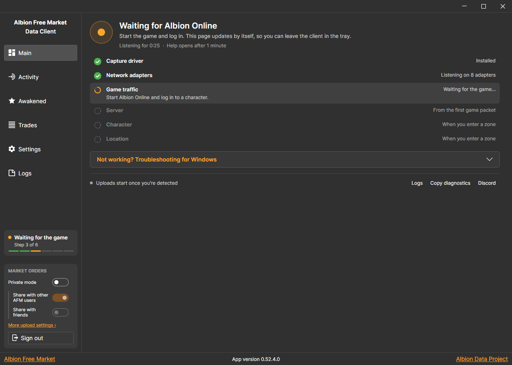
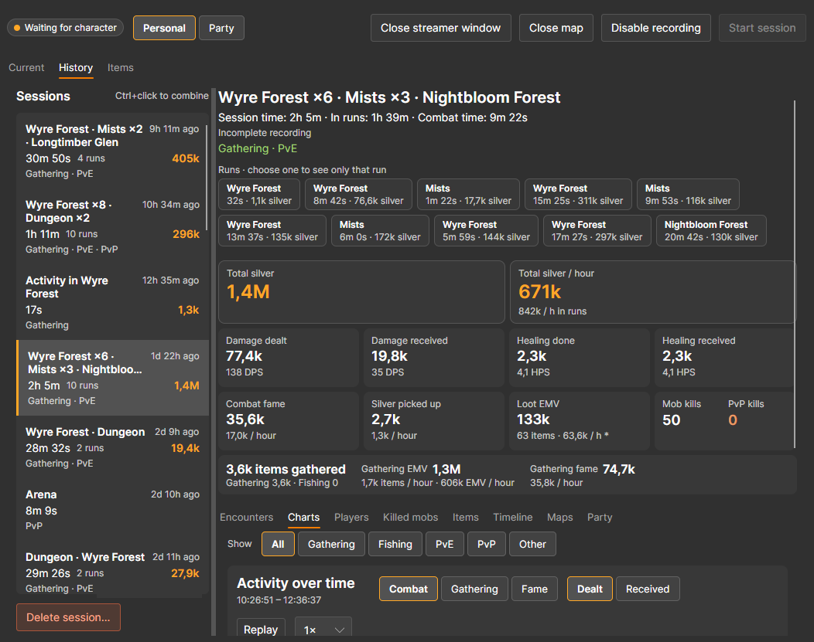
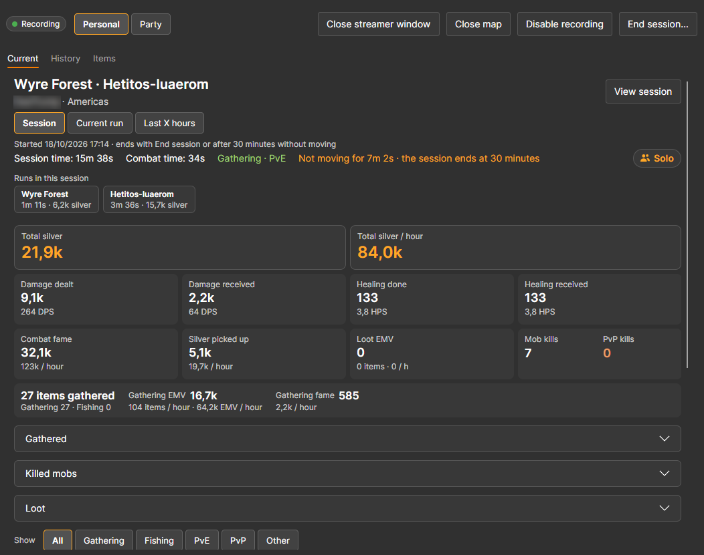
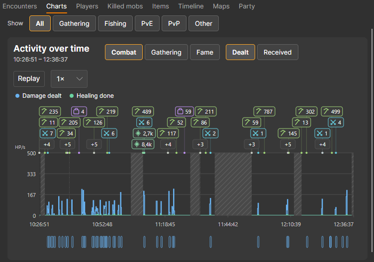
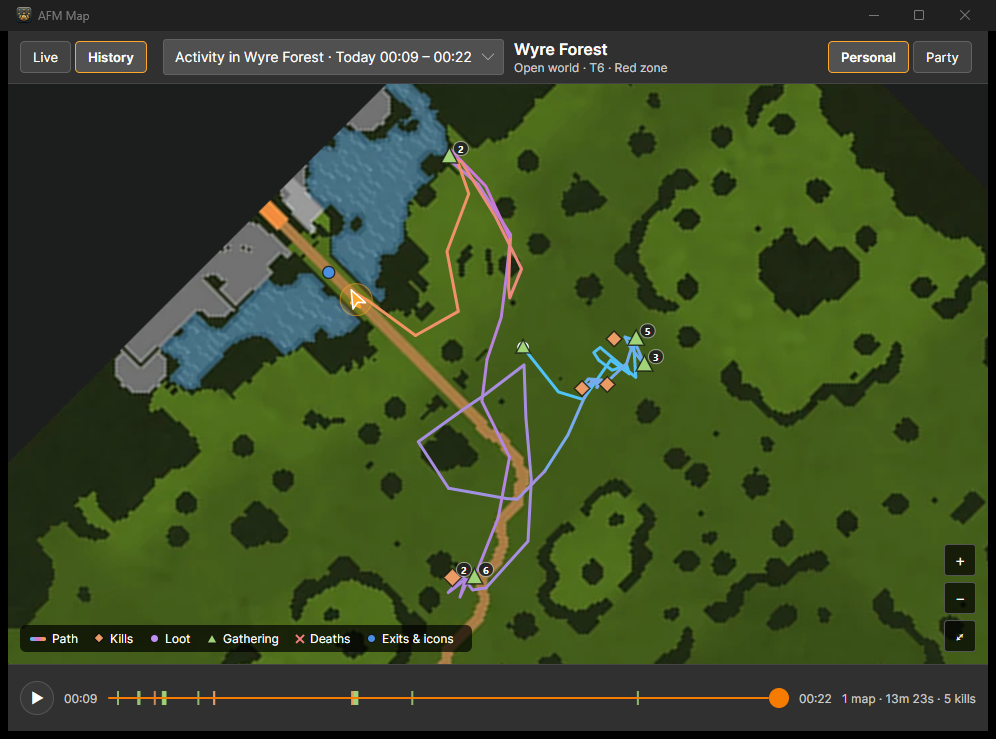
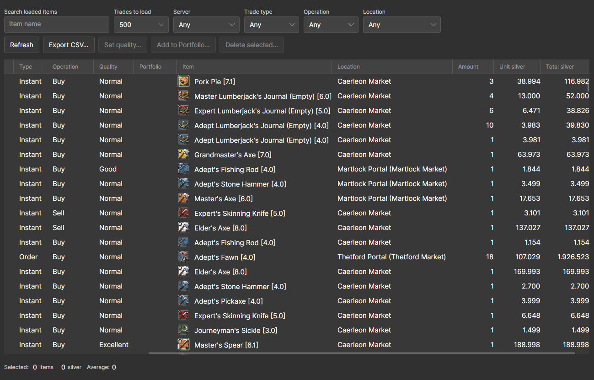
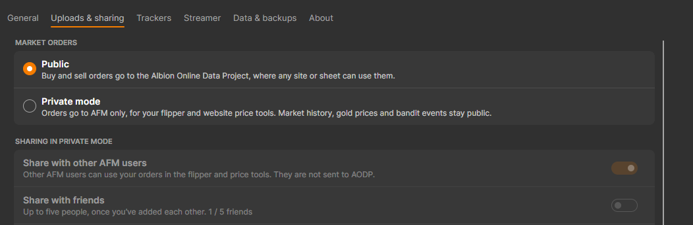

# Albion Free Market Data Client

[](https://github.com/JPCodeCraft/AlbionDataAvalonia/releases)
[](https://tooomm.github.io/github-release-stats/?username=jpcodecraft&repository=AlbionDataAvalonia)

A free, open-source companion app for Albion Online on Windows, Linux and macOS. Leave it running while you play and it:

- uploads market prices to [The Albion Online Data Project](https://www.albion-online-data.com/) (AODP), which [Albion Free Market](https://albionfreemarket.com/) and many other community sites use;
- records your combat, gathering, fishing and loot into sessions, with totals, charts and a map of where you went;
- keeps a searchable history of your market trades and awakened items.

**[Download the latest release](https://github.com/JPCodeCraft/AlbionDataAvalonia/releases/latest)** · [Installation tutorial](https://albionfreemarket.com/articles/view/albion-free-market-data-client-tutorial) · [Data Client page](https://albionfreemarket.com/data-client) · [AFM Discord](https://discord.com/invite/BPmDE3zznH)

> **Run only one data client.** If you use this client, uninstall the official AODP client, or both will upload the same data twice.



## Contents

- [Installation](#installation)
- [First start](#first-start)
- [Activity](#activity)
- [Trades](#trades)
- [Awakened items](#awakened-items)
- [Settings](#settings)
- [Signing in to AFM](#signing-in-to-afm)
- [FAQ](#faq)

## Installation

The client runs on anything that runs Albion Online; on macOS it needs macOS 14 or newer. It reads the game's network traffic, so it needs a packet capture driver: Npcap or WinPcap on Windows, libpcap on Linux, and a one-time permission on macOS. The steps below cover each one.

### Windows

1. Download `AFMDataClientSetup_v_x.x.x.x.exe` from the [latest release](https://github.com/JPCodeCraft/AlbionDataAvalonia/releases/latest).
2. Run the installer. If no capture driver is installed yet, it installs WinPcap for you.
3. The client opens when setup finishes. It starts with Windows, and closing the window keeps it running in the system tray. To quit, right-click the tray icon and choose Exit.
4. Updates download and install by themselves.

If the Main tab says the capture driver is missing, click **Download Npcap**, install [Npcap](https://npcap.com/#download) with the default options, and click **Check again**.

**Uninstall** from Windows **Installed apps**. The uninstaller asks whether to keep your history and settings.

### Linux

Install libpcap first if you don't have it (`sudo apt install libpcap0.8` or `sudo dnf install libpcap`).

**Option 1: one-line installer**

```bash
curl -s https://api.github.com/repos/JPCodeCraft/AlbionDataAvalonia/releases/latest | jq -r '.assets[] | select(.name == "AFMDataClient_Linux64_Installer.sh") | .browser_download_url' | xargs curl -L -o installer.sh && sed -i 's/\r$//' installer.sh && chmod +x installer.sh && ./installer.sh && rm installer.sh
```

**Option 2: manual installation**

1. Download `AFMDataClient_Linux64_Installer.sh` from the [latest release](https://github.com/JPCodeCraft/AlbionDataAvalonia/releases/latest).
2. Fix line endings: `sed -i 's/\r$//' AFMDataClient_Linux64_Installer.sh`
3. Make it executable: `chmod +x AFMDataClient_Linux64_Installer.sh`
4. Run it: `./AFMDataClient_Linux64_Installer.sh`

The installer gives the client permission to capture packets and adds it to your startup apps.

**Uninstall**

```bash
curl -s https://api.github.com/repos/JPCodeCraft/AlbionDataAvalonia/releases/latest | jq -r '.assets[] | select(.name == "AFMDataClient_Linux64_Uninstaller.sh") | .browser_download_url' | xargs curl -L -o uninstaller.sh && sed -i 's/\r$//' uninstaller.sh && chmod +x uninstaller.sh && ./uninstaller.sh && rm uninstaller.sh
```

> The Linux version doesn't update itself. Run the installer again to update. It has had limited testing, so feedback and contributions are welcome.

### macOS

The macOS version needs macOS 14 or newer. On Apple Silicon download `AFMDataClient_MacOS_arm64.app.zip`; on Intel download `AFMDataClient_MacOS_x64.app.zip`.


The app isn't signed, so macOS may say `"AFMDataClient_MacOS" is damaged and can't be opened`. Remove the download quarantine flag before opening it:


1. Make sure `AFMDataClient_MacOS.app` is in your `Downloads` folder. Safari may extract the zip by itself; if you only see the `.zip`, double-click it first.

   

2. Open Terminal: press `Command + Space`, type `Terminal` and press `Return`.

   

3. Go to your Downloads folder:

   ```bash
   cd ~/Downloads
   ```

4. Remove the quarantine flag:

   ```bash
   xattr -dr com.apple.quarantine AFMDataClient_MacOS.app
   ```

   

5. Drag `AFMDataClient_MacOS.app` into your `Applications` folder.
6. Open `AFMDataClient_MacOS.app` from `Applications`. If double-clicking doesn't open it, run:

   ```bash
   open /Applications/AFMDataClient_MacOS.app
   ```

The first time, the Main tab shows `Allow packet capture on this Mac` and the sidebar reads `Capture not set up`. Click **Install permissions** on the Main tab or in the sidebar, approve the administrator prompt, and let the app restart.


Once it restarts, log in to the game and the Main tab checks the rest, as in [First start](#first-start).

Older installations show an **Update permissions** button instead. Run it once to replace the old permission service.

The client tells you when a new version is out, but on macOS you download and install updates yourself.

**Uninstall**

1. Quit the client from the menu bar tray icon.
2. Remove the packet capture permission service in Terminal:

   ```bash
   sudo /bin/sh "/Applications/AFMDataClient_MacOS.app/Contents/Resources/uninstall-capture-permissions.sh"
   ```

   If you kept the app somewhere other than `Applications`, change the path. It's safe to run even if permissions were never installed.

3. Move `AFMDataClient_MacOS.app` from `Applications` to the Trash.

This keeps your history, backups, settings and logs. To delete those too, run this only once you're sure you don't need them:

```bash
rm -rf "$HOME/Library/Application Support/AFMDataClient"
```

## First start

Open the client and start Albion Online. The **Main** tab checks each step for you: capture driver, network adapters, game traffic, server, character and location. It updates by itself, so you can leave the client in the tray. Uploads start once your character is detected.

If a step gets stuck, open **Not working? Troubleshooting** on the Main tab for steps for your system. **Copy diagnostics** copies a report you can paste in the [AFM Discord](https://discord.com/invite/BPmDE3zznH). It covers your setup, network adapters, uploads and recent warnings, and leaves out your character, guild, email, IP address and file paths.

The sidebar always shows the current status, and the **Market orders** box below it switches between public uploads and Private mode (see [Signing in to AFM](#signing-in-to-afm)).

## Activity

The **Activity** page records what you do in the game: damage and healing, fame, mob and player kills, gathering and fishing, loot pickups and silver. It all happens in the background and stays on your computer.



### How sessions work

Your activity is saved in sessions. A session starts when you leave a city, Rest, portal town or hideout for the open world, a dungeon or the Mists, or when you press **Start session** on the Activity page. Nothing you do in town, like crafting, farming or trading, starts one. Its time runs until you press **End session**, switch character, turn recording off, or stop moving for 30 minutes. Leaving the game or closing the client pauses it, and it continues if you're back within 30 minutes.

Each dungeon, Mists visit or stretch of open world is a **run** inside the session, from when you enter it, and each fight is an **encounter**.

**Personal** shows only you. **Party** adds the people in your party.

### Current

**Current** shows the session you're playing right now: total silver and silver per hour, damage and healing with DPS and HPS, combat fame, silver picked up, loot value, kills, and everything you gathered and fished. Switch between the whole **Session**, the **Current run** or the **Last X hours**. A chart at the bottom follows the last 5, 10 or 15 minutes.



### History

**History** lists every saved session with its zones, length and silver. Pick one to see the same totals, then choose a run to see only that part. The tabs below break the session down into encounters, charts, players, killed mobs, loot, gathering (fishing included), a timeline, the maps you visited and your party.

Ctrl-click or Shift-click sessions to combine them, and use **Delete session…** to remove one.



The chart shows damage or healing over time, with markers for kills, loot and gathering, and the fights along the bottom. Use **Show** to filter by gathering (fishing included), PvE or PvP, and **Replay** to play the session back.

### Items

**Items** adds up everything you looted and gathered across all your sessions. Use **Time** to see today, yesterday, the last 7 or 30 days, or a custom range of dates and times. Search by item, player or source, filter by loot or gathering (fishing counts as gathering), and use **Export loot…** to save the loot you see as a CSV file.

Loot and gathered items are valued with AFM's estimated market value (EMV). Signing in to AFM lets the client look up values for items it hasn't priced yet.

### Map

Click **Open map** on the Activity page to open the map in its own window.



- **Live** follows you through the zone and draws your path, kills, loot, gathering, deaths, zone exits and map icons. Choose whether they fade after 1, 5 or 15 minutes, or never.
- **History** replays any past run. Pick it from the list and press play, or drag along the timeline.

### Streamer window

Click **Open streamer window** for a small window with your current session's numbers that you can capture in OBS or another streaming app. Choose what it shows, its size and a green background for chroma key in **Settings › Streamer**.

### Turning it off

Press **Disable recording** on the Activity page, or turn off **Record activity** in **Settings › Trackers**. Your saved history stays readable. To free space, delete old sessions in **Settings › Data & backups**.

## Trades

**Trades** keeps every instant buy and sell you make at the market, plus completed buy and sell orders read from your market mails. Filter by item, server, trade type, operation and location, select rows to see their total and average price, and export them to CSV. The CSV's **Order Amount** column holds each order's full size, and orders that expired with nothing filled are listed too, with an amount of 0, so you can work out what their setup fees cost. Signed-in users can also send trades to their AFM Portfolio.



## Awakened items

**Awakened** saves the awakened items you see in the game, with who they're attuned to, strain, attunement, PvP fame and traits. Open one in the AFM calculator, or, when signed in, list it for sale on AFM.

## Settings



- **General**: the update channel (**Stable** or **Beta**), what the window does when the client starts, starting with your system, and whether minimize and close hide it in the tray.
- **Uploads & sharing**: public or Private mode for market orders, sharing, character specs, the island tracker and upload speed.
- **Trackers**: turn activity recording and awakened items on or off.
- **Streamer**: what the streamer window shows.
- **Data & backups**: storage used, deleting old history, and automatic backups.
- **About**: your version, links, and a diagnostics mode for bug reports.

## Signing in to AFM

Everything above works without an account, and public uploads to AODP never need one. Click **Sign in** in the sidebar and sign in with Google to also:

- use **Private mode**, which sends your buy and sell orders only to AFM for your flipper and website price tools instead of AODP. Market history, gold prices, bandit events and festivities stay public. You can share your private orders with other AFM users, or with up to five friends who add each other in **Settings › Uploads & sharing**;
- upload your character specs to the AFM website;
- track your island plots and farming;
- add trades to your AFM Portfolio and list awakened items for sale.

## FAQ

### Is this allowed by the Albion Online developers?

> "Our position is quite simple. As long as you just look and analyze we are ok with it. The moment you modify or manipulate something or somehow interfere with our services we will react (e.g. perma-ban, take legal action, whatever)."
>
> — MadDave, Technical Lead at Sandbox Interactive for Albion Online, 2017 ([source](https://forum.albiononline.com/index.php/Thread/51604-Is-it-allowed-to-scan-your-internet-trafic-and-pick-up-logs/?postID=512670#post512670))

The client:

- ✅ does not modify the game client
- ✅ does not inject code into memory
- ✅ does not draw overlays on the game
- 🛜 only reads the network packets the game already receives

You are responsible for following Sandbox Interactive's rules, which can change.

### It isn't detecting the game. What can I do?

Open **Not working? Troubleshooting** on the Main tab. Ping boosters and VPNs (ExitLag, WTFast, NoPing and similar) can route game traffic where the client can't see it, so pause them and change zones. When no traffic arrives, the Main tab names any it finds running. If you use ExitLag, set `Packets redirection method` to `Legacy - NDIS` under `TOOLS`:


Still stuck? Click **Copy diagnostics** and paste it in the [AFM Discord](https://discord.com/invite/BPmDE3zznH).

### How do I get beta versions?

Choose **Beta** under **Settings › General › Update channel**. Beta builds arrive first and can have bugs. You can also download them from the [releases page](https://github.com/JPCodeCraft/AlbionDataAvalonia/releases).

### Where is my data stored, and how do I move it to another PC?

Your history, settings and backups are all in one folder:

| System | Folder |
| --- | --- |
| Windows | `C:\Users\<username>\AppData\Local\AFMDataClient` |
| Linux | `~/.local/share/AFMDataClient` (or `$XDG_DATA_HOME/AFMDataClient`) |
| macOS | `~/Library/Application Support/AFMDataClient` |

To move it, quit the client from the tray, copy the whole `AFMDataClient` folder to the same place on the new computer, and start the client.

### How do I restore a backup?

The client makes a backup every 24 hours and keeps the three newest, plus ones about 5, 10 and 15 days old. **Settings › Data & backups** opens the backup folder and shows these steps:

1. Quit the client from the tray and make sure it's no longer running.
2. Copy the current `data` folder somewhere safe.
3. Extract the backup ZIP you want.
4. In the `data` folder, move aside `afmdataclient.db` and any `afmdataclient.db-wal` or `afmdataclient.db-shm` files.
5. Copy the extracted `afmdataclient.db` into the `data` folder.
6. Start the client, check your history, and sign in again (backups don't include your sign-in).

## Links

- [Albion Free Market](https://albionfreemarket.com/)
- [The Albion Online Data Project](https://www.albion-online-data.com/)
- [Download statistics](https://tooomm.github.io/github-release-stats/?username=jpcodecraft&repository=AlbionDataAvalonia)

Made by [JP CodeCraft](https://jpcodecraft.com/), the developer behind Albion Free Market. Free and open source; see the [license](LICENSE).
